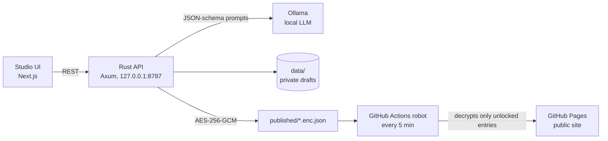

# Datedly-AI

**One prompt. One AI. A complete calendar. Almost any idea.**

Datedly AI turns a natural-language idea ("a 24-day MMA Advent calendar with
quizzes and challenges", "a 14-day Python course", "a 7-day Paris discovery
trip"...) into a complete, editable, publishable calendar, using a local AI
(Ollama).

## Architecture

| Part | Tech | Role |
| --- | --- | --- |
| `frontend/` | Next.js, TypeScript, Tailwind | Studio interface (local) and public site (GitHub Pages) |
| `backend/` | Rust, Axum, Tokio, Serde | Local studio API: storage, calendar engine, AI providers |
| Ollama | local models | Generates calendar content on your computer |
| GitHub Actions | CI + Pages | Tests every push, deploys the public site |

Generation happens **locally** (Ollama cannot be reached by GitHub). Calendars
are stored privately in `data/` (git-ignored). Published calendars are
encrypted entry by entry, so future entries are never readable before their date.



## Run it locally

Requirements: Node 22+, Rust (stable), [Ollama](https://ollama.com) with at
least one text model (`ollama pull qwen3:8b` for example).

```bash
# 1. Backend: studio API on http://localhost:8787
cd backend
cargo run

# 2. Frontend: studio on http://localhost:3000 (second terminal)
cd frontend
npm install
npm run dev
```

## Studio features

- **Editor** (`/calendar?id=…`, tab *Edit*): title, description, visual theme,
  schedule (first date, daily / weekly / monthly / every N days, unlock time,
  time zone), add / delete / drag-and-drop entries, edit every content block
  (text, fact, story, challenge, steps, quiz, link, illustration idea).
  *Rewrite with AI* regenerates one entry, optionally following an instruction
  ("turn it into a quiz"); the result goes into the draft and is only stored
  when you click **Save** (Ctrl+S). The server validates every save
  (quiz answers, https-only links, lengths, time zone).
- **Toolkit** (`/toolkit`): prompt builder, prompt recipes, checklist, model
  guide (shows what is installed), editing tips, shortcuts, troubleshooting.
- **Languages**: the interface switches between English and French (EN / FR in
  the top bar, remembered in the browser). Labels inside a calendar follow the
  calendar's own language.

## How generation works

1. **Understand**: the AI extracts a brief (title, audience, tone, language,
   number of entries, interval, start date, formats, visual theme).
2. **Plan**: it outlines every entry and groups them into sections, knowing
   the real publication date of each one (seasonal content lands on the right month).
   Repeated entries in the plan are replaced.
3. **Write**: entries are written in batches of 4. Every AI answer is
   constrained by a JSON schema (Ollama structured outputs) and parsed in Rust.
4. **Check & repair**: missing entries, empty bodies and broken quizzes are
   rewritten (2 rounds). Duplicated titles or near-identical entries are reported.
   Dates are always computed by Rust, never by the AI. Only `https` links are kept.
5. **Build**: the calendar is saved as a private draft in `data/`.

Progress is shown live in the studio. One generation runs at a time (one local GPU).
Calendars are limited to 60 entries for now: local models are slow.

The quality of the content depends on the model: `qwen2.5:7b` gives the best
results in our tests; 3B models work but repeat themselves more.
Local models can state wrong facts: review the content before publishing.

## Publishing

1. In the studio, **Publish** a calendar: the API seals every entry with its own
   key (AES-256-GCM, derived from a master key with HKDF) and writes
   `published/<slug>.enc.json`. This folder can be committed safely.
2. The **Publish calendars** workflow (`.github/workflows/publish.yml`) runs on
   every push and every 5 minutes. `datedly-publish` decides with the server
   clock which entries are unlocked, decrypts only those and writes the public JSON.
3. The static site is rebuilt and deployed to GitHub Pages only when something changed.

One-time setup: **Settings → Pages → Source: GitHub Actions**, then add the
repository secret `DATEDLY_MASTER_KEY` (content of `data/master.key`, created on
first publish). GitHub cron runs in UTC and may start a few minutes late.

## Configuration

Backend (all optional):

| Variable | Default | Purpose |
| --- | --- | --- |
| `DATEDLY_PORT` | `8787` | Port of the studio API (always bound to `127.0.0.1`) |
| `DATEDLY_DATA_DIR` | `../data` | Private drafts, settings and master key |
| `DATEDLY_PUBLISH_DIR` | `../published` | Encrypted bundles |
| `DATEDLY_ALLOWED_ORIGIN` | `http://localhost:3000` | CORS origin of the studio |
| `DATEDLY_MASTER_KEY` | read from `data/master.key` | Base64 master key (used by the publish robot) |
| `RUST_LOG` | `info` | Log level |

Frontend: `NEXT_PUBLIC_API_URL` (see `frontend/.env.example`).

## API overview

| Method | Route | Description |
| --- | --- | --- |
| GET | `/api/health` | Health check |
| GET | `/api/ai/status` | Ollama reachability and installed models |
| GET/PUT | `/api/settings` | Studio settings (Ollama endpoint, model) |
| POST | `/api/generate` | Start a generation job from a prompt |
| GET | `/api/jobs/current`, `/api/jobs/{id}` | Generation progress |
| GET/POST | `/api/calendars` | List / create calendars |
| GET/PUT/DELETE | `/api/calendars/{id}` | Read / save (validated) / delete |
| POST | `/api/calendars/{id}/regenerate` | Regenerate a whole calendar |
| POST | `/api/calendars/{id}/entries/regenerate` | Rewrite one entry with an instruction |
| POST | `/api/calendars/{id}/publish`, `/unpublish` | Seal / remove a public bundle |
| GET | `/api/public/{slug}` | Public view (only unlocked entries) |

## Tests and CI

```bash
cd backend && cargo fmt --check && cargo clippy -- -D warnings && cargo test   # unit tests: scheduling, validation, crypto, Ollama client
cd frontend && npm run lint && npx tsc --noEmit && npm run build
```

The **CI** workflow runs both on every push and pull request; Dependabot keeps Cargo, npm and Actions dependencies up to date.

## Roadmap

1. **Foundation**: architecture, Ollama detection, model selection, data models ✅
2. **AI generation**: prompt → brief → plan → entries, schema-constrained JSON, validation and repair ✅
3. **Calendar editor**: preview, edit, rewrite one entry with an instruction, regenerate all, reorder, dates, themes, drafts ✅
4. **Publishing**: encrypted bundles, public pages, server-side unlocking, scheduled GitHub Actions ✅
5. Quality: more tests (API integration, frontend), security review, docs

## License

[MIT](LICENSE)
